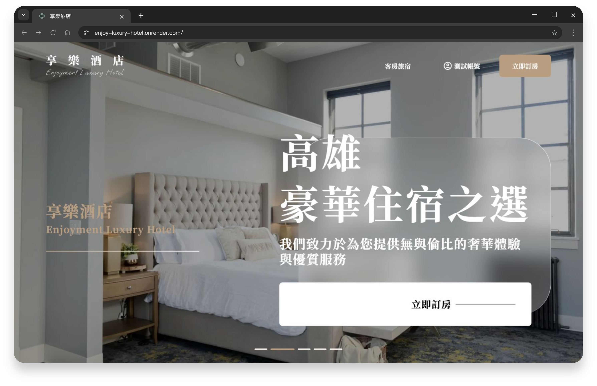

# 享樂酒店 - 旅館訂房網


> 以旅館住宿為主題，提供房型與設施介紹、會員管理及訂房流程。



## 📋 專案概述

此專案以 TypeScript、Nuxt 3 與 Tailwind CSS 開發，練習響應式切版、API 串接與完整訂房操作。從房型瀏覽、日期與人數選擇，到會員資料與訂單查詢，呈現前端頁面與後端資料整合。

**[Demo](https://enjoy-luxury-hotel.onrender.com/)** · [會員登入](https://enjoy-luxury-hotel.onrender.com/auth/login) · [設計稿](https://www.figma.com/design/JfhEX5JHpFTzJphireJols/%E9%85%92%E5%BA%97%E8%A8%82%E6%88%BF%E7%B6%B2%E7%AB%99?node-id=0-1&t=WolCT4gcKPy5eVyD-1) · [API 文件](https://enjoy-luxury-hotel-back.onrender.com/swagger/)

## 🔨 核心技術

<table>
    <tbody>
    <tr>
        <td><a href="https://nuxt.com/"> Nuxt 3 </a></td>
        <td>頁面路由與伺服器端渲染</td>
    </tr>
    <tr>
        <td>
        <a href="https://vuejs.org/"> Vue 3 </a>
        </td>
        <td>JavaScript 框架</td>
    </tr>
    <tr>
        <td>
        <a href="https://www.typescriptlang.org/"> TypeScript </a>
        </td>
        <td>JavaScript 的超集</td>
    </tr>
    <tr>
        <td>
        <a href="https://tailwindcss.com/"> Tailwind CSS </a>
        </td>
        <td>CSS 框架</td>
    </tr>
    </tbody>
</table>

## 🛠️ 擴展套件

<table>
    <tbody>
        <tr>
            <td>
                <a href="https://github.com/googlemaps/js-api-loader"> Google Maps </a>
            </td>
            <td>載入交通位置地圖</td>
        </tr>
        <tr>
            <td>
                <a href="https://vee-validate.logaretm.com/v4/"> vee-validate </a>
            </td>
            <td>登入、註冊及訂房表單驗證</td>
        </tr>
        <tr>
            <td>
                <a href="https://day.js.org/"> dayjs </a>
            </td>
            <td>住宿日期與天數處理</td>
        </tr>
        <tr>
            <td>
                <a href="https://gsap.com/"> GSAP </a>
            </td>
            <td>頁面轉場與捲動動畫</td>
        </tr>
        <tr>
            <td>
                <a href="https://swiperjs.com/"> nuxt-swiper </a>
            </td>
            <td>房型與圖片輪播</td>
        </tr>
        <tr>
            <td>
                <a href="https://sweetalert2.github.io/"> SweetAlert2 </a>
            </td>
            <td>確認視窗與操作回饋</td>
        </tr>
        <tr>
            <td>
                <a href="https://vcalendar.io/"> v-calendar </a>
            </td>
            <td>入住與退房日期選擇</td>
        </tr>
        <tr>
            <td>
                <a href="https://github.com/validatorjs/validator.js"> Validator </a>
            </td>
            <td>Email 與密碼格式檢查</td>
        </tr>
        <tr>
            <td>
                <a href="https://onycat.com/vue-easy-lightbox/"> vue-easy-lightbox </a>
            </td>
            <td>房型圖片燈箱</td>
        </tr>
        <tr>
            <td>
                <a href="https://vueuse.org/"> VueUse </a>
            </td>
            <td>響應式工具與互動處理</td>
        </tr>
    </tbody>
</table>

## 🌸 啟動指南

使用專案指定的 Node 22 LTS：

```sh
nvm use
npm ci
cp .env.example .env
# 將 NUXT_PUBLIC_API_BASE 設為後端網址
npm run dev
```

## 使用說明

鑰匙可帶入測試帳號。共用帳號的帳密固定，請勿填入個人資訊。

免費服務冷啟動可能需要等待；訂房逾時請先查看會員訂單。忘記密碼寄信目前不可用；未提供庫存控管、付款或訂房通知郵件。
